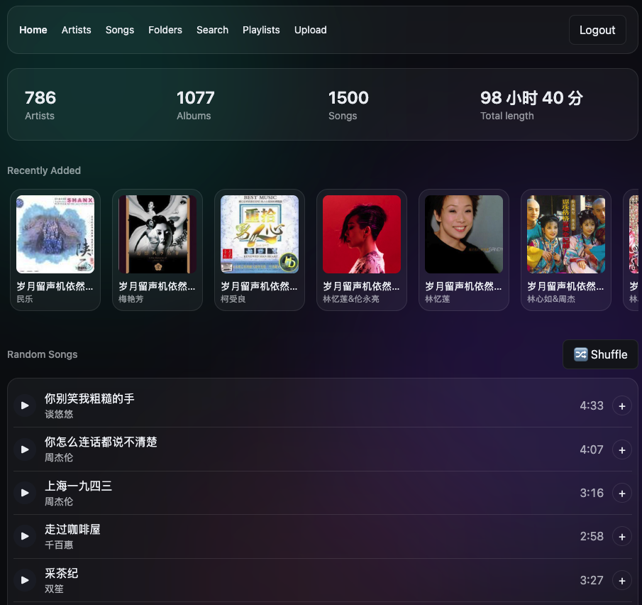
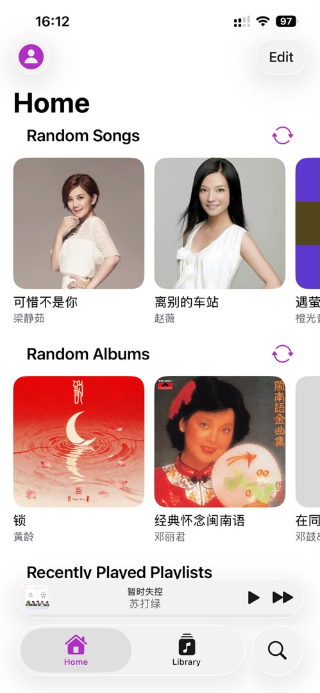

# Subsonic Telegram

*English | [中文](README-CN.md)*

Turn Telegram into a free, effectively unlimited-capacity personal music cloud: a Cloudflare Worker that directly implements the [Subsonic REST API](http://www.subsonic.org/pages/api.jsp). Audio files themselves live in a private Telegram channel (via the official Bot API — no rclone/WebDAV middleman), while metadata lives in Cloudflare D1. Any Subsonic-compatible client (Amperfy, DSub, Ultrasonic, substreamer, ...) can connect directly to browse, play, and manage playlists.

There's no long-running server in this setup — the Worker is invoked per-request, D1 and Telegram are both managed services, and seeking/scrubbing during playback rides on the standard HTTP Range support that Telegram's file-download endpoint natively provides (verified in practice), no extra workarounds needed.

**Current limitation**: a single audio file must be under 20MB (a hard limit of the Telegram Bot API's `getFile`); larger files are skipped during import. If larger files (e.g. lossless albums) need to be supported down the line, chunking or switching to MTProto/another storage backend would be the way to go.



## Requirements

- A Telegram account (to create a bot and a private channel — see [Prerequisite](#prerequisite-create-a-telegram-bot-and-channel) below)
- A Cloudflare account (Workers + D1 are both on the free tier for personal-scale use)
- Node.js 22+ and npm, for local scripts and building the Web UI
- The [Wrangler CLI](https://developers.cloudflare.com/workers/wrangler/) (`npm install -g wrangler`, or use `npx wrangler`), logged in with `wrangler login`

## Contents

- [Architecture](#architecture)
- [R2 read-through cache (optional)](#r2-read-through-cache-optional)
- [Project layout](#project-layout)
- [Implemented endpoints](#implemented-endpoints)
- [Connecting a Subsonic client](#connecting-a-subsonic-client)
- [Prerequisite: create a Telegram bot and channel](#prerequisite-create-a-telegram-bot-and-channel)
- [Deployment: Cloudflare Git integration](#deployment-cloudflare-git-integration-workers-builds)
- [Importing a local music library](#importing-a-local-music-library)
- [Playlists](#playlists)
- [Web UI](#web-ui)
  - [Managing the library from the Web UI](#managing-the-library-from-the-web-ui)
- [Local development / testing](#local-development--testing)
- [Security / single-user assumptions](#security--single-user-assumptions)
- [Contributing](#contributing)
- [License](#license)

## Architecture

```
Subsonic client
   ↕ HTTPS /rest/*.view
Cloudflare Worker (src/index.ts — routing + auth + Subsonic response building)
   ↕
Cloudflare D1 (artists/albums/tracks/playlists metadata)
   ↕ file_ref (JSON: {messageId, fileId})
Telegram Bot API (sendDocument to upload / getFile + file CDN to download, Range supported)
```

The storage layer is an interface (`src/storage/types.ts`) with a Telegram implementation (`src/storage/telegram.ts`) as the source of truth for every file. In front of that sits an optional R2 read-through cache (`src/storage/cached.ts`, see below) — enabled only if you bind an R2 bucket; without it, every request talks to Telegram directly, same as before that cache existed.

## R2 read-through cache (optional)

By default, every `stream`/`download` request re-fetches the whole file from Telegram (its file CDN doesn't reliably honor Range requests, so the Worker always pulls the full file and slices out the requested bytes itself — see the comment in `src/storage/telegram.ts`). That's fine at low volume, but it means repeated plays or a listener scrubbing the seek bar repeatedly re-download the same file from Telegram, and it leans on Telegram's Bot API rate limits under concurrent listeners.

Binding an R2 bucket turns this into a real cache: the first stream of a file downloads it from Telegram once and writes it to R2; every subsequent request (including Range requests from seeking) is served straight out of R2 — cheaper, faster, and no repeat Telegram calls. This is entirely optional and off by default; nothing else changes if you skip it.

**To enable:**

```bash
wrangler r2 bucket create subsonic-telegram-cache
```

Then uncomment the `[[r2_buckets]]` block in `wrangler.toml` and run the schema migration once (adds the `cache_entries` accounting table — see [`db/schema.sql`](db/schema.sql)):

```bash
npm run db:migrate:remote
```

Redeploy and the cache is live. There's no size limit on the library itself — the cache only ever holds files that have actually been streamed (lazily populated, never pre-warmed), so a 50GB library with a handful of frequently-played tracks might only ever cache a few hundred MB.

**Eviction**: total cache size is capped by `CACHE_MAX_BYTES` (bytes; see the `[vars]` example in `wrangler.toml`), defaulting to 8GB if unset. Whenever a new file is written to the cache, the Worker checks the running total (tracked in D1, not by listing the bucket) and — if over the cap — deletes the least-recently-served entries first until it's back under. R2's free tier includes 10GB-month of storage and unlimited egress, so an 8GB cap comfortably fits inside it.

## Project layout

| Path | Purpose |
|---|---|
| `src/index.ts` | Worker entry point, routes by `/rest/<endpoint>.view`, authenticates before dispatching |
| `src/auth.ts` | Subsonic auth (token or plaintext password); credentials come from the `AUTH_USERNAME`/`AUTH_PASSWORD` Worker secrets, never stored in a database. `src/md5.ts` is the accompanying dependency-free MD5 implementation (Web Crypto doesn't support MD5) |
| `src/subsonic/` | Response building (`node.ts`/`response.ts` — one tree that serializes to either JSON or XML) and per-endpoint business logic |
| `src/db/queries.ts` | All D1 queries |
| `src/storage/` | Storage backend interface + the Telegram implementation, plus the optional R2 cache (`cached.ts`) |
| `db/schema.sql` | D1 table definitions |
| `scripts/import.ts` | Local import script: scans a local music directory, reads tags, uploads to Telegram, writes to D1 |
| `scripts/import-m3u.ts` | Builds/updates Subsonic playlists from local `.m3u`/`.m3u8` files |
| `scripts/fix-covers-remote.ts` | GitHub Actions entry point for repairing missing covers from remote D1 without reading local music files |
| `web/` | The bundled Web UI (Vue 3 + Vite), served alongside the API by Workers Static Assets once built — see [Web UI](#web-ui) below |

## Implemented endpoints

`ping` `getLicense` `getMusicFolders` `getIndexes` `getArtists` `getArtist` `getAlbum` `getSong` `getAlbumList2` `getGenres` `search3` `stream` `download` `getCoverArt` `getPlaylists` `getPlaylist` `createPlaylist` `updatePlaylist` `deletePlaylist` `getRandomSongs` `scrobble` `star` `unstar` `getStarred` `getStarred2` `setRating` `getLyrics` `getOpenSubsonicExtensions` `getLyricsBySongId` `getPlayQueue` `savePlayQueue` `getArtistInfo` `getArtistInfo2` `getTopSongs` `getSimilarSongs2`

`scrobble` (`submission=true`, the default) increments the track's `play_count` and updates `last_played`; `submission=false` ("now playing" notifications) is currently ignored outright. `star`/`unstar` accept any combination of `id` (track) / `albumId` / `artistId`. `getStarred`/`getStarred2` return the same favorites data, just under a different top-level tag (`starred` vs `starred2`) — both use this project's native ID3 structure. `setRating` sets a track's 1–5 star `userRating` (`rating=0` clears it); ratings are per-track only, no album/artist rating.

`getRandomSongs` blends in recent activity rather than picking uniformly at random: 30% of the results are drawn from starred (favorite) tracks and 30% from the most recently added 100 tracks, with the rest genuinely random — so both favorites and new music surface in the feed without crowding out discovery.

`getLyrics` looks up plain-text lyrics from [LRCLIB](https://lrclib.net) (a free, keyless lyrics database) by exact `artist`+`title` match, using whatever the client sends for those two params. There's a small cleanup-and-retry fallback (still exact matching, not fuzzy): if the direct match misses, it strips decorative title suffixes (`情火（DJ）` → `情火`, `演员 (男女和声氛围版)` → `演员`) and takes just the first name when multiple artists are joined into one tag (`张紫宁、李鑫一` → `张紫宁`), then retries once. Measured against this project's own library, that recovers only a handful of otherwise-missed tracks — most misses are LRCLIB genuinely not having the song, which no amount of query cleverness fixes (its coverage skews international/mainstream; Mandopop/Cantopop deep cuts, DJ remixes, and web-singer covers are hit or miss). There's still no fuzzy/title-only search beyond that: with messy tags (e.g. a compilation folder where the artist field is wrong or "Various Artists"), a title-only search tends to return confident-looking wrong matches (covers, live versions, same-titled songs) more often than it helps, so a genuine miss just returns empty lyrics rather than guessing. LRCLIB's own synced (LRC) lyrics are flattened to plain text here, since the classic `getLyrics` response has no field for timing data — see `getLyricsBySongId` below for the synced version. The bundled Web UI's player bar has a 🎤 button that fetches and shows these lyrics in a modal, lazily (only on click, not on every track change) — see [Web UI](#web-ui) below.

`getOpenSubsonicExtensions` advertises support for the `songLyrics` [OpenSubsonic](https://opensubsonic.netlify.app) extension, and `getLyricsBySongId` is its `id`-based counterpart to `getLyrics` — some clients (confirmed with **Amperfy**) gate lyrics entirely behind this extension check and never even call the classic `getLyrics`, so without these two a track can have real lyrics and the client still shows none. Unlike `getLyrics`, this one can return real per-line timing (`<line start="12340">...`) when LRCLIB has synced (LRC) lyrics for the match, which is what lets clients like Amperfy do scrolling/karaoke-style lyrics instead of a flat text blob; falls back to unsynced lines when only plain lyrics are available. Uses the same LRCLIB lookup (and the same cleanup-and-retry fallback) as `getLyrics` — a track found by one is found by the other. If lyrics still don't show up in a client after this, its cached "does this server support `songLyrics`" flag was probably set to `false` from before this endpoint existed — restarting the app or forcing a library re-sync clears that.

`getPlayQueue`/`savePlayQueue` persist one play queue per user (there's only ever one — this is a single-user server, not per-session history) in a small `play_queue` table: the track id list, which one's current, and the position in milliseconds. This is what lets a client resume across devices/sessions — start on the phone, pick up the same queue and position on the web UI later. `savePlayQueue` takes repeated `id` params for the queue, plus `current`/`position`; `getPlayQueue` returns just `<playQueue username="…"/>` with no entries if nothing's been saved yet.

`getTopSongs`/`getSimilarSongs2` are normally backed by Last.fm (artist bios, a real similar-artists graph); rather than add an external dependency and an API key just for these two, both are approximated from data already in D1. `getTopSongs` takes an artist *name* (a quirk of the classic Subsonic spec, which predates ID3 browsing) and returns that artist's tracks sorted by `play_count`. `getSimilarSongs2` has no real "similar artists" graph to draw on, so it blends the artist's own other tracks (60%, `SIMILAR_SONGS_ARTIST_RATIO`) with random tracks from other artists sharing that artist's most common genre (the rest) — the same "blend a few related signals" approach `getRandomSongs` already uses for favorites/recent tracks, just applied to a different signal.

**Artist images**: every artist's `coverArt` is its own id, and `getCoverArt` resolves an artist id to that artist's photo (`artists.cover_ref`, filled by `npm run fix-covers -- --artist-photos`, see below), falling back to the cover of one of their albums (newest first), then any per-track cover, then the placeholder. `getArtistInfo`/`getArtistInfo2` return only `smallImageUrl`/`mediumImageUrl`/`largeImageUrl` (no biography or similar artists — those come from Last.fm on real servers); since clients load these as plain image URLs without adding credentials, they point at `getCoverArt` with the caller's own auth params copied in. Databases created before `artists.cover_ref` existed need `ALTER TABLE artists ADD COLUMN cover_ref TEXT;` once (see `db/schema.sql`).

**Client compatibility note**: some Subsonic clients (confirmed with Amperfy) probe the bare server root `/` before making any real API calls, and treat a non-2xx response as "server doesn't exist," which makes login fail with a 404. Since `/` (along with any other non-`/rest/*` path) is now served by the Web UI's static assets, it's naturally a `200`, which incidentally fixes this compatibility issue too — see [Web UI](#web-ui) below.

## Connecting a Subsonic client

This is the whole point of the project, worth calling out explicitly: this Worker is a **real Subsonic server**, not a bespoke app that only works with the bundled Web UI. The [Subsonic API](http://www.subsonic.org/pages/api.jsp) is an open protocol that originated with the old Subsonic media server and today is spoken by a whole ecosystem of self-hosted servers (Navidrome, Airsonic, Ampache, gonic, ...) and, more usefully here, by dozens of existing client apps across every platform. Because this project implements that exact protocol (see [Implemented endpoints](#implemented-endpoints) above), any of those apps already works with it — nothing to build, no plugin, no custom integration.

**Some popular clients**, pick whichever fits your platform — all of these connect to any Subsonic-compatible server, this one included:
- iOS: Amperfy, play:Sub, SubStreamer
- Android: DSub, Ultrasonic, Symfonium, substreamer
- Desktop / cross-platform: Feishin, Sublime Music (Linux), Supersonic

**Setup is identical in every one of them** — three fields:

| Field | Value |
|---|---|
| Server address | your Worker's URL, e.g. `https://music.example.com` (no `/rest` suffix — the client appends that itself) |
| Username | whatever you set `AUTH_USERNAME` to (see [Deployment](#deployment-cloudflare-git-integration-workers-builds) step 4) |
| Password | whatever you set `AUTH_PASSWORD` to |

No self-signed certificate hassle and no "allow insecure/HTTP" toggle to flip — Cloudflare issues a real TLS certificate for your domain like any other site, so every client's default HTTPS-only mode just works. If a client asks for an API version, `1.16.1` (or "auto") is fine.

In practice it looks like this — a stock mobile Subsonic client browsing and playing straight from the Worker, no custom app needed:



Want to check the server itself before pointing a client at it? That's exactly what the `curl .../ping.view` check in [Deployment step 7](#deployment-cloudflare-git-integration-workers-builds) is for.

## Prerequisite: create a Telegram bot and channel

This is the step newcomers get stuck on most — it has nothing to do with Cloudflare, it's pure Telegram setup. By the end you'll have two values, `TG_BOT_TOKEN` and `TG_CHANNEL_ID`, which you'll enter as Worker secrets during deployment (step 4 below).

1. **Create a bot**: open [@BotFather](https://t.me/BotFather) in Telegram and send `/newbot`. Follow the prompts to pick a display name and a username (the username must end in `bot`). BotFather replies with a string like `123456789:AAH...` — that's your `TG_BOT_TOKEN`. Keep it safe; whoever has it has full control of the bot. Never commit it to the repo.
2. **Create a private channel**: in your Telegram client, create a new Channel and set its type to **Private** (this channel exists purely to store audio files — it doesn't need to be, and shouldn't be, public). Once created, add the bot from step 1 as a channel administrator (Administrators → Add Admin), and make sure it has at least the "Post Messages" permission — otherwise uploads will fail. Also grant "Delete Messages" if you want the Web UI's delete-track feature to actually remove the file from Telegram — without it, deleting a track still removes it from the library (D1), but the Telegram message is left behind (harmless, same class of leftover as an interrupted `npm run import`).
3. **Get the channel's `chat_id` (i.e. `TG_CHANNEL_ID`)**: a channel's chat_id is a large negative number starting with `-100` — it's not the same thing as the channel's `@username`, so you need this numeric form. Two ways to get it:
   - Easiest: post any message in the channel, then forward that message to [@getidsbot](https://t.me/getidsbot) (or any similar "get chat id" bot) — it will reply with the full chat_id, `-100` prefix included.
   - Or manually: make sure the bot is already a channel admin, post a message in the channel, then open `https://api.telegram.org/bot<TG_BOT_TOKEN>/getUpdates` in a browser. Look for `channel_post.chat.id` in the returned JSON — that's your `TG_CHANNEL_ID`.
4. Keep both values handy — you'll need them during deployment (step 4 below) or for local development (`.env`/`.dev.vars`).

## Deployment: Cloudflare Git integration (Workers Builds)

This project is deployed by connecting the Worker to this GitHub repo through the Cloudflare Dashboard — **not** by running `wrangler deploy` locally. The effect: every push to `main` gets automatically pulled by Cloudflare, `npm install`ed, and built/deployed per `wrangler.toml`, with no manual trigger needed.

That only solves "how the code gets published," though. The following are things **the Git integration will never do for you and that you must do by hand once** — because they're either stateful resources (databases, secrets) or simply aren't triggered by code changes:

`wrangler.toml` in this repo already has a real `database_id` (deployment is up and running). Steps 1–2 below are only relevant **when setting up a brand-new instance from scratch**, kept here for reference:

**1. Create the D1 database** (do this manually, under the **same** Cloudflare account the Git integration is connected to — Cloudflare doesn't create the database automatically):

```bash
wrangler d1 create subsonic-telegram
```

**2. Write the returned `database_id` back into `wrangler.toml`, then commit + push**

The Git integration reads its config from `wrangler.toml` in the repo. If the placeholder isn't replaced and pushed, the D1 binding will never connect.

**3. Create the tables** (one-time; re-run this whenever `db/schema.sql` changes — pushing code does not run migrations automatically)

Either:
- Local `wrangler` (requires being logged in to the same Cloudflare account this Worker is deployed under):
  ```bash
  wrangler d1 execute subsonic-telegram --remote --file=./db/schema.sql
  ```
- Or call Cloudflare's **D1 HTTP API** directly (doesn't depend on a local wrangler login — `scripts/import.ts` and friends use this same path; you'll need an API token with D1 Edit permission):
  ```bash
  curl -s -X POST "https://api.cloudflare.com/client/v4/accounts/<CF_ACCOUNT_ID>/d1/database/<D1_DATABASE_ID>/query" \
    -H "Authorization: Bearer <CF_API_TOKEN>" -H "Content-Type: application/json" \
    -d "$(jq -Rs '{sql: .}' db/schema.sql)"
  ```

**4. Configure Worker secrets** (unrelated to code, never set by a git push, and must never be committed to the repo): your Telegram credentials (`TG_BOT_TOKEN`/`TG_CHANNEL_ID`, from [Prerequisite: create a Telegram bot and channel](#prerequisite-create-a-telegram-bot-and-channel) above) plus your login credentials (`AUTH_USERNAME`/`AUTH_PASSWORD`, used to log in from Subsonic clients — pick any username/password you like; this is for single-user personal deployments only)

Either:
- Locally (requires `wrangler whoami` to be logged in to the same account as the Git integration):
  ```bash
  wrangler secret put TG_BOT_TOKEN
  wrangler secret put TG_CHANNEL_ID   # full chat_id, including the -100 prefix
  wrangler secret put AUTH_USERNAME
  wrangler secret put AUTH_PASSWORD
  ```
- Or add all four manually via Cloudflare Dashboard → this Worker → Settings → Variables and Secrets.

Set once and it persists on the Worker — later git-push-triggered redeploys won't clear it. Login credentials are never stored in a database or written to any config file; they live only in the Worker's encrypted secrets, and `src/auth.ts` compares them directly against client login requests.

**5. Set the build command** (needed for the Web UI — see [Web UI](#web-ui) below): Cloudflare Dashboard → this Worker → Settings → Build → Build command, set to `npm run build`. Workers Builds does not automatically run the `build` script from `package.json`; without setting this, the Web UI won't get bundled into the deployment (the `web/dist` directory that `[assets] directory` in `wrangler.toml` points to will be empty/missing, and the deploy will fail outright).

**6. (Optional) Custom domain**: add a domain under the Worker's Settings → Domains & Routes, then configure the matching Cloudflare DNS record. This isn't the same as a traditional "nginx reverse proxy + Origin CA certificate" setup — Workers custom domains get their certificates issued directly by Cloudflare, no nginx/certificate wrangling required.

**7. Verify**: `curl https://<your-worker>/rest/ping.view?u=<username>&p=<password>&v=1.16.1&c=test&f=json` should return `{"subsonic-response":{"status":"ok",...}}`.

## Importing a local music library

The import script talks to Cloudflare through the D1 HTTP API (D1 bindings only work from inside a Worker, so a plain Node script has to go through REST instead).

1. Copy `.env.example` to `.env` and fill in:
   - `TG_BOT_TOKEN` / `TG_CHANNEL_ID`: the same values used for the Worker secrets
   - `CF_ACCOUNT_ID`: your Cloudflare account ID
   - `CF_API_TOKEN`: a token with D1 edit permission
   - `D1_DATABASE_ID`: the database_id returned by `wrangler d1 create` in step 2 above
2. Run:
   ```bash
   npm run import -- /path/to/music
   npm run import -- /path/to/music --limit=300   # override the default 100-files-per-run cap
   ```
   This recursively scans the directory for mp3/flac/m4a/ogg/opus/wav files (automatically skipping macOS AppleDouble shadow files starting with `._`, which show up on non-HFS+ volumes — they aren't audio, and importing them just produces a pile of zero-duration "Unknown Artist" junk tracks). It reads tags (artist/album/title/year/genre/cover art), uploads to Telegram, and writes to D1. Files over 19MB are skipped with a warning. **Each run uploads at most 100 new files** (override with `--limit=`), then exits; for a large library, run the same command multiple times — the local state file (see point 3 below) automatically picks up where it left off, without re-uploading anything.
3. Already-imported files are tracked in a local `.import-state.json` (not committed to git); re-running the same directory automatically skips them, and you can interrupt and re-run anytime. **Deduplication only checks this local file, not D1** (a deliberate tradeoff to save D1 read quota) — the downside being that if this file is lost or you move to a different machine, re-running will re-upload the same batch of files to Telegram (D1 won't end up with duplicate rows, since a conflicting track id gets blocked by `ON CONFLICT DO NOTHING`, but the redundant Telegram messages from the wasted upload won't be referenced by anything).
4. Each track records a `source_path` (its path relative to the directory you passed on the command line at import time) — this is the key [Playlist](#playlist) matching relies on to match `.m3u` entries to tracks. **Always pass the same root directory** (it's recommended to fix this to your `LOCAL_MUSIC_DIR` value) — otherwise the same song will compute a different `source_path` across import runs and won't match up.

## Playlists

`getPlaylists`/`getPlaylist`/`createPlaylist`/`updatePlaylist`/`deletePlaylist` all implement standard Subsonic semantics, so clients can create/edit/delete playlists normally.

Besides letting a client create playlists itself, you can also bulk-generate them from existing local `.m3u`/`.m3u8` files:

```bash
npm run import-m3u -- /path/to/playlist.m3u
```

This works by taking each file path listed in the `.m3u`, converting it to a path relative to `LOCAL_MUSIC_DIR` (or the directory given via `--music-dir=`), and matching it against already-imported tracks in D1 by exact `source_path`. **So any song referenced in the `.m3u` must already have been imported via `npm run import`** — anything not yet imported gets listed at the end, prompting you to import it first. Re-running the same `.m3u` file updates the same-named playlist (its id is derived deterministically from the name), rather than creating a duplicate.

### Artist photos

```bash
npm run fix-covers -- --artist-photos [--limit=N] [--dry-run] [--retry-failed]
```

Fills `artists.cover_ref` with a Deezer photo (free, no key) for each artist that doesn't have one yet, uploading it to Telegram like any other cover. Photos already uploaded by a `--loose-fallback` run (`.artist-photo-refs.json`) are reused without hitting Deezer again, and a `--loose-fallback` run that finds a new artist photo now writes it to `artists.cover_ref` too. Artists Deezer has no photo for are recorded as `no-match` in `.cover-fix-state.json` and skipped next time (`--retry-failed` clears that).

### Automatic cover repair

The GitHub Actions workflow `.github/workflows/fix-covers.yml` runs daily at 02:00 UTC and can also be started manually. It invokes the separate `fix-covers:remote` script, which checks only albums/tracks created in the last 48 hours, checks D1 `cover_ref` values, and never reads a local music directory or `.cover-fix-state.json`; D1 is the source of truth on every run.

Add these repository secrets before enabling the workflow: `TG_BOT_TOKEN`, `TG_CHANNEL_ID`, `CF_ACCOUNT_ID`, `CF_API_TOKEN`, and `D1_DATABASE_ID`. The Cloudflare API token needs permission to query the target D1 database.

## Web UI

`web/` is a Vue 3 + Vite single-page app that calls the `/rest/*` API directly (the same interface third-party Subsonic clients use), providing a browsing/playback/playlist-management UI, plus a file-manager-style Folders page (multi-select, move, rename, recursive delete) and batch upload (files or whole folders) for managing the library directly from the browser (bulk import still stays the CLI script's job — see [Managing the library from the Web UI](#managing-the-library-from-the-web-ui) below).

**Pages**: Home (library stats + recently added/recently played/most played), Artists (browse by ID3 artist/album), Songs (a flat, sortable, paginated track list), Folders (browse by the original local folder structure — see below), Favorites (starred songs/albums/artists via `getStarred2`, with Play all/Shuffle), Search, Playlists.

**Player**: shuffle (🔀 in the player bar toggles it for the current queue; "🔀 Shuffle" buttons start a shuffled queue straight away — on album, playlist (detail page and each row of the playlist list), artist, folder (including subfolders), Favorites and Songs ("Shuffle all", the whole library), plus "Shuffle library" next to Home's Random Songs. The artist/folder/library ones fetch a uniformly random sample of up to 500 tracks via `getShuffleSongs`, this project's own endpoint; turning shuffle off restores the original order), repeat off/all/one, and a volume slider (shuffle/repeat/volume are remembered in `localStorage`). The queue is synced to the server with `savePlayQueue` and restored paused at the saved position via `getPlayQueue` on load, so it resumes across reloads and from other Subsonic clients; only a window of 200 tracks around the current one is saved, since every id goes in the query string. On phones (≤600px) the player bar wraps into two rows — cover/title/controls, then the progress bar with lyrics/queue — and hides the star rating and volume slider. Lock-screen/notification controls and hardware media keys work through the Media Session API. ☰ in the player bar opens the queue (jump to or remove any track, or clear it); the ⋯ menu on every track row has "Play next" and "Add to queue".

**What "Folders" is**: it reconstructs the original folder tree from `source_path` (recorded by `npm run import`, relative to the import root directory), as an alternative to the ID3-tag-based grouping that Artists uses. This is especially useful for "compilation" folders (e.g. a monthly hits chart) — where each song's ID3 artist tag differs, so browsing by Artists scatters them across dozens or hundreds of artist names, while browsing by Folders preserves the original "one folder, one compilation" structure intact. The backing endpoints (`getFolder`, `getFolderTree`, `getFolderSongs`, `moveItems`, `renameTrackFile`, `deleteItems`, `getTrackStorage`, `getTrash`, `restoreTrash`, `purgeTrash`, `updateTracks`, `setCoverArt`, `getDuplicates`, …; logic in `src/subsonic/folders.ts`, `src/subsonic/trash.ts` and `src/subsonic/metadata.ts`) — like `getLibraryStats`/`getSongs`/`getRecentlyPlayed`/`getMostPlayed` — aren't part of the official Subsonic protocol; they only exist to serve this project's own Web UI.

### Managing the library from the Web UI

**Uploading** works in batches. Drop audio files or whole folders onto any Folders page (they go into the folder you're looking at), use its "⬆ Upload ▾" button (files or a folder), or the Upload page in the nav bar (defaults to this month's `Uploads/YYYY-MM` folder). A review dialog comes first: the destination folder (editable), each file with the tags read from it, optional artist/album/genre/year to apply to the whole batch, files that are too large, and files whose name already exists in the destination, which you can either skip or upload as `name (1).ext`. Dropped folders keep their structure under the destination; non-audio files that came along (covers, `.lrc`, `.cue`…) are left out. Uploads then run in the background from a queue shown in a panel at the bottom right, two at a time, with per-file progress. They keep going while you browse other pages, can be cancelled or retried one by one, and the Folders view refreshes as they finish.

- Tags (artist/album/title/year/genre/track/disc number) are read client-side in the browser, via `music-metadata`'s `parseBlob`. A file without tags still uploads: the title falls back to the file name and the album to its folder's name (skipping `CD1`/`Disc 2`-style folders). The Worker itself does no tag parsing — this keeps it dependency-free and running in the plain Workers runtime, same as everywhere else in `src/`.
- Telegram accepts roughly 20 uploads a minute per channel. When it answers 429, `uploadTrack` passes on its `retryAfter`, and the queue pauses for that long (with a countdown in the panel) before carrying on — big batches just take a while.
- The file goes to Telegram before anything is written to D1, so a failed upload leaves no empty artist/album behind. A file with the same name and album as one in another folder gets its own track id instead of being mistaken for that one.
- Same 19MB cap as `npm run import` (Telegram's `getFile` download limit) — a file that uploaded past that could never be streamed back, so it's rejected client-side and server-side both.
- Cover art isn't uploaded with the songs; a new album created this way has no cover until you add one (see "Editing tags and covers" below).
- **Deleting a track** (the 🗑 button on Songs/Album rows — not on playlist or search views, which have their own non-destructive "remove from playlist"/nothing) moves it to the trash (see below).

**The Folders page works like a file manager**:

- **Layout**: a folder tree on the left (hidden below 1024px wide), breadcrumb, a sortable list (name/title·artist/length/size/added; folders always first, each with its recursive song count, size and length) or a cover grid, and a "Search in this folder…" box that searches the folder and everything under it, showing which subfolder each hit is in.
- **Selecting**: click a row to select it, Ctrl/⌘-click to add or remove, Shift-click for a range, or use the checkboxes. On touch screens, long-press a row to start selecting. Clicking a name (or double-clicking a row) opens the folder or plays the song.
- **Actions**: right-click, the ⋯ on each row, or the bar that appears once something is selected: Play / Play next / Add to queue / Add to playlist (a folder counts as everything under it, up to 500 songs per folder), Move to…, Rename, Download (songs only — saved under the file's real name), Properties (tags, format, play count, the Telegram message it lives in, and whether it's in the R2 cache), Delete.
- **Keyboard**: Delete (or ⌘/Ctrl+Backspace) deletes, F2 renames, Enter opens or plays, Backspace goes up a folder, Ctrl/⌘+A selects all, ↑/↓ move the selection, Esc clears it.
- **Moving**: "Move to…" picks a destination from the folder tree, or you can drag the selection onto a folder row, a tree entry or a breadcrumb segment. Whole folders move with everything in them. If a name is already taken at the destination, you're asked whether to keep both (the moved one becomes `name (1).mp3`) or skip those items. A folder you moved or deleted everything out of stays around, empty, rather than disappearing.
- **Renaming** a file only changes its file name (the last segment of `source_path`), not its title tag. Renaming a folder refuses a name already in use instead of silently merging two folders. Neither touches Telegram.
- **Deleting** works on any mix of songs and folders, recursively, and moves them to the trash — no confirmation, but the toast that follows has an Undo. "Delete forever…" in the menu (or Shift+Delete) skips the trash, after a confirmation showing how many songs and bytes that is.
- "+ New folder" registers the path in a small `folders` D1 table — folders are otherwise purely derived from tracks' `source_path`, so this is how a folder can exist with nothing in it. Listings merge both sources.

Folder listings read per-folder totals off an index on a `dir` column (the parent of `source_path`, a generated column — see `db/schema.sql`) instead of loading every track below the folder, and all prefix matching uses `[prefix + "/", prefix + "0")` ranges rather than `LIKE`, so `_`/`%` in folder names match literally. Multi-select requests send their ids as a POSTed form body (the OpenSubsonic `formPost` extension, which any client can use), since hundreds of ids won't fit in a URL.

**Trash**: deleting from the web UI moves things to the trash (Folders sidebar → 🗑 Trash, or the 🗑 button in the Folders toolbar on narrow screens) instead of deleting them. A deleted folder is one trash entry, holding everything that was under it; each individually deleted song is its own entry. The rows leave the live tables, so trashed songs disappear from every view and from third-party clients right away, but nothing on Telegram is touched yet. **Restoring** puts back the tracks and everything deleted along with them: albums/artists that had become empty, favorites, folder registrations, and playlist entries (at their old position if that slot is still free, otherwise at the end of the playlist). A song whose old name has been taken meanwhile comes back as `name (1).mp3`. **Deleting forever** (per entry, or "Empty trash") deletes the Telegram files with `deleteMessages`, 100 per call; very large purges are split across several requests. Entries older than `TRASH_RETENTION_DAYS` (a `[vars]` setting, default 30) are purged by a daily Cron Trigger (`[triggers]` in `wrangler.toml`, `scheduled()` in `src/index.ts`). Telegram deletes that fail — for example because the bot lacks the "Delete Messages" permission — are queued in a `pending_deletes` table and retried by the same cron instead of leaving orphaned messages behind; the Trash page shows how many are waiting.

The trash, retry queue and their indexes are plain `CREATE TABLE IF NOT EXISTS`, so `npm run db:migrate:remote` adds them to an existing database.

**Editing tags and covers**: "Edit tags…" in the Folders menu (any mix of songs and folders — a folder means every song under it), the ✎ button on Songs/Album rows, and "✎ Edit" on an album page (name, album artist, year, genre, cover). These change the library's metadata in D1 only; the audio files in Telegram are never rewritten. Song ids don't change, so favorites, ratings, play counts and playlists stay attached. Changing the artist or album moves the songs to the album with that name — the same one an upload with those tags would land in, so renaming onto an existing album merges into it — and albums/artists left empty are removed, with their favorites moved along. Year and genre are stored per album, so they apply to the whole album. A new cover (or artist photo, from the artist page) is resized in the browser to at most 1200px, stored in Telegram, and the old image deleted unless something else (including a trash entry) still uses it.

**Duplicates** (Folders sidebar → ⧉ Duplicates): groups of songs with the same title and artist and about the same length (within 3 seconds), or of exactly the same size and format. The first song of each group is the suggested one to keep — a favorite, then higher rating, bitrate, size, play count. "Select all but the suggested" and one click moves the rest to the trash, with Undo.

**Upgrading an existing database** (one created before the `dir` column existed) needs this once before deploying, then `npm run db:migrate:remote` as usual to create its index:

```bash
wrangler d1 execute subsonic-telegram --remote --command "ALTER TABLE tracks ADD COLUMN dir TEXT GENERATED ALWAYS AS (rtrim(rtrim(source_path, replace(source_path, '/', '')), '/')) VIRTUAL"
```

**Styling**: Tailwind CSS v4 (via `@tailwindcss/vite`, no separate `postcss.config.js` needed), a single dark theme, hand-rolled `.glass` frosted-glass cards plus fixed, blurred gradient "aurora" background blobs — no light/dark theme toggle.

**How it's wired into the Worker**: via Cloudflare Workers' Static Assets feature, configured in `wrangler.toml`:

```toml
[assets]
directory = "./web/dist"
binding = "ASSETS"
run_worker_first = ["/rest/*"]
not_found_handling = "single-page-application"
```

`run_worker_first` only applies to `/rest/*`, meaning every other path (`/`, `/playlists/xxx`, etc.) **never reaches `src/index.ts`** — Cloudflare serves it statically from `web/dist` directly (`not_found_handling = "single-page-application"` lets Vue Router's client-side routing handle refreshes/direct navigation and still resolve to `index.html`). This is also why the earlier special-case patch for Amperfy's root-path probing was removed — `/` is now naturally answered by the real `index.html`.

**Auth model**: the login screen collects a username and password and, like other Subsonic clients, stores them in the browser locally (`localStorage`), attaching them to every subsequent API/`stream`/`getCoverArt` request — meaning the password shows up in these requests' URL query parameters (visible in browser history, the Performance API, etc). This is an inherent property of Subsonic's classic auth scheme itself, not a risk newly introduced by this Web UI, and is acceptable for a personal, single-user deployment.

**Local development**:

```bash
cd web
npm install
npm run dev              # proxies /rest to http://127.0.0.1:8787 (wrangler dev) by default
VITE_API_PROXY_TARGET=https://<your-worker> npm run dev   # or proxy directly to a deployed backend
```

**Build/deploy**: running `npm run build` at the repo root (= `npm --prefix web ci && npm --prefix web run build`) produces `web/dist`, which gets published alongside the Worker via `[assets]` when you run `wrangler deploy` or deploy through the Git integration. **You must run this build once before the first local `wrangler dev`/`wrangler deploy`** — if `web/dist` doesn't exist, wrangler will refuse to start with an error. The Git integration path uses the Cloudflare Dashboard's Build command (see deployment step 5 above) instead of this local `npm run build` — both need to be kept in sync.

## Local development / testing

```bash
npm run db:migrate:local   # create a local D1 (wrangler's local simulation)
npm run dev                # wrangler dev, reads Telegram credentials from .dev.vars
```

`.dev.vars` has the same contents as `.env` (Telegram credentials) — it's the local secrets file wrangler dev uses specifically; neither file is committed to git.

For local testing you can insert a few fake rows directly into the local D1 (`wrangler d1 execute subsonic-telegram --local --command "..."`), and test `stream`/`getCoverArt` against real Telegram credentials, since Telegram's side is always the real API regardless of local vs. remote.

## Security / single-user assumptions

- `AUTH_PASSWORD` is stored as plaintext in Worker secrets: Subsonic's classic token auth (`t = md5(password + salt)`) requires the server to have the plaintext password on hand to recompute the hash — there's no way around this. This is designed for personal use; don't use a password here that you reuse elsewhere.
- There's no multi-user support, no permission isolation, and no rate limiting. The current scope is "for my own use," not a public service meant to host other people's accounts.

## Contributing

Issues and pull requests are welcome — this is a personal-scale project, so please keep the single-user design goals above in mind (no multi-tenant auth, no rate limiting) rather than treating them as gaps to fix. For anything beyond a small fix, opening an issue first to discuss the approach is appreciated.

## License

[MIT](LICENSE)
